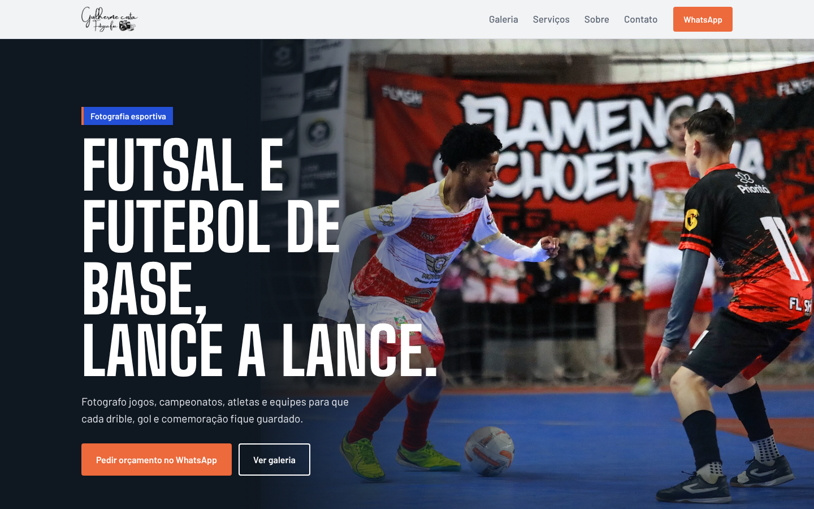

# Guilherme Costa · Sports photography

Website for a youth sports photographer (futsal and football): a gallery of his photos, services and quote requests through WhatsApp.

🔗 **Website:** [guilhermecostafotogrgafia.netlify.app](https://guilhermecostafotogrgafia.netlify.app)

> The website itself is in Portuguese, because it is made for local clients.

## Features

- **Hero with his best photo** and a direct call to action to WhatsApp
- **Masonry gallery** that keeps each photo's shape, with a **full-screen viewer**: arrow keys, swipe on mobile and Esc to close
- **Services** (matches and tournaments, athletes, teams), each with a pre-filled WhatsApp message
- **How it works** in 3 steps, about and contact

## Version 2 (what changed)

- The site now shows the photographer's real work (youth sports). Stock photos and services he doesn't offer were removed
- **Optimized photos:** from up to 4160 px and 2 MB each to 1800 px (≈250 KB), plus 720 px thumbnails that only load when they appear on screen
- Visual identity inspired by the court floor (blue and orange), with condensed sports typography
- Photographer's signature with a transparent background, to use on any color
- SEO and sharing: description, preview image (Open Graph), alt text on every photo
- Accessibility: keyboard navigation, visible focus, skip link to the gallery, `prefers-reduced-motion` support
- Fewer dependencies: removed ScrollReveal, Swiper, Remix Icon and Boxicons. JavaScript is now only used for the gallery

## Tech stack

HTML · CSS · JavaScript · Netlify

## Author

Website by **Anderson Frota** · [andersonfrota.netlify.app](https://andersonfrota.netlify.app) · [LinkedIn](https://www.linkedin.com/in/andersongfrota)
